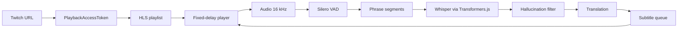

subany.video es un experimento pequeño con una promesa deliberadamente estrecha: pega un enlace de Twitch y mira el directo con subtítulos traducidos. Sin cuenta, sin instalación, sin extensión. El vídeo, el reconocimiento de voz y la traducción se ejecutan en el navegador.

Esa promesa es también la restricción de diseño. Cada decisión técnica que viene a continuación está subordinada a ella: si una función hacía más lento o más frágil el camino de «pegar y ver», se quedaba fuera. El resultado no es una plataforma de transcripción de propósito general. Es un reproductor que se retrasa a propósito unos segundos respecto al directo para tener audio suficiente con el que reconocer, traducir y mostrar frases completas.

Este artículo repasa las piezas que lo hacen funcionar. Los fragmentos de código proceden del prototipo de la fase 0, que a día de hoy vive en un repositorio privado.

## Qué es y qué restricción manda

La entrada es la URL de un canal de Twitch. La salida es ese mismo directo en un reproductor HLS propio, con subtítulos en el idioma del espectador.

Hay tres propiedades que importan más que todo lo demás:

- **Sin cuenta.** El espectador nunca inicia sesión y el producto nunca se la pide.
- **Sin instalación.** Todo llega como una página web.
- **Procesamiento local.** El audio se transcribe y se traduce en la máquina del espectador, usando WebGPU cuando está disponible y la CPU cuando no.

El prototipo admite un retardo fijo de 10, 15 o 20 segundos, con 15 segundos por defecto. Ese retardo es el compromiso central: es el margen que necesita el sistema para convertir un flujo de audio en directo en texto legible y sincronizado.

## La arquitectura de un vistazo

El proceso tiene dos mitades. Una mantiene en reproducción un flujo HLS retrasado; la otra convierte el audio que ya está en el búfer en subtítulos y se los devuelve al reproductor.



El reproductor y el worker están separados a propósito. El reproductor controla los tiempos del vídeo; el worker controla el procesamiento del audio. Cada subtítulo se crea con la hora real de inicio y fin de su frase, de modo que puede mostrarse sobre el vídeo retrasado sin necesidad de un segundo reloj.

## El reproductor con retardo fijo

Una lista de reproducción HLS en directo no conserva todo el flujo. En las mediciones de la fase 0, Twitch mantenía disponibles aproximadamente **28–30 segundos** de vídeo. Esperar a un retardo de 15 segundos desperdiciaría la mayor parte de esa ventana y haría lento el arranque, así que el reproductor normalmente salta hacia atrás en cuanto tiene búfer suficiente. Si la ventana disponible es demasiado corta para ese salto, recurre a pausar y acumular el retardo.

La configuración de hls.js sigue directamente el retardo objetivo:

```ts
// src/reproductor/retraso.ts
export function configHls(objetivoSeg: number) {
  return {
    liveSyncDuration: objetivoSeg,
    liveMaxLatencyDuration: objetivoSeg + 20,
    maxLiveSyncPlaybackRate: 1,          // nunca acelerar para alcanzar el borde del directo
    maxBufferLength: objetivoSeg * 2,
    lowLatencyMode: false,
  };
}
```

`maxLiveSyncPlaybackRate: 1` es deliberado. Normalmente hls.js puede reproducir algo más rápido para recuperarse de la latencia, pero acelerar el vídeo rompería la relación entre el audio y los subtítulos que se sincronizaron con él. El reproductor se mantiene a velocidad normal y corrige su posición a saltos.

Un salto solo se permite cuando el retardo se ha desviado más de dos segundos por encima del objetivo:

```ts
// src/reproductor/retraso.ts
export function debeResincronizar(latenciaSeg: number, objetivoSeg: number, margenSeg = 2): boolean {
  return latenciaSeg > objetivoSeg + margenSeg;
}
```

El controlador muestrea la latencia cada cinco segundos. Si la pestaña está oculta y Chrome pausa un vídeo silenciado, el retardo puede crecer hasta 29–31 segundos; cuando el espectador vuelve, el reproductor salta al borde del directo menos el retardo objetivo. La comprobación se omite mientras la pestaña está oculta para que el reproductor no luche contra el comportamiento de pausa del navegador.

Al arrancar hay dos modos. `saltar` es el camino rápido descrito arriba: hay historial suficiente, así que el reproductor retrocede de inmediato. `acumular` pausa la reproducción mientras hls.js sigue cargando hasta alcanzar la latencia objetivo. La elección es una decisión de una línea:

```ts
// src/reproductor/retraso.ts
export function planificarRetraso(ventanaSeg: number, objetivoSeg: number, margenSeg = 2): 'saltar' | 'acumular' {
  return ventanaSeg >= objetivoSeg + margenSeg ? 'saltar' : 'acumular';
}
```

## Cómo acceder a un directo de Twitch

Twitch no expone una URL de reproducción pública y sencilla. El prototipo sigue el mismo camino que el reproductor web oficial:

1. Solicitar un `PlaybackAccessToken` al endpoint GQL de Twitch.
2. Construir con ese token una URL de lista maestra HLS en `usher.ttvnw.net`.
3. Leer las listas de variantes y los segmentos de medios desde la CDN de Twitch.

La petición del token usa el Client-ID público de la web y una consulta GQL persistida. Esta parte funciona desde cualquier origen porque GQL devuelve cabeceras CORS permisivas. La lista maestra es distinta: `usher.ttvnw.net` solo permite `twitch.tv`, y las listas de variantes de audio y vídeo devuelven **403** a un origen público de terceros. Los segmentos de medios, en cambio, se pueden descargar con CORS `*`.

Esa asimetría es la razón de ser del proxy mínimo. Solo reenvía listas de texto: unos pocos kilobytes cada dos segundos por espectador. El vídeo y el audio nunca pasan por él. El prototipo tiene tres modos de acceso: `directo`, cuando el navegador puede alcanzarlo todo; `proxy-listas`, cuando solo las listas necesitan el intermediario; y `proxy-todo`, cuando la petición del token también tiene que pasar por él.

```ts
// src/twitch/acceso.ts
export function urlMaestra(canal: string, token: { valor: string; firma: string }, via: ViaAcceso): string {
  const u = new URL(`https://usher.ttvnw.net/api/v2/channel/hls/${canal.toLowerCase()}.m3u8`);
  const p: Record<string, string> = {
    platform: 'web',
    p: String(Math.floor(Math.random() * 999999)),
    allow_source: 'true',
    allow_audio_only: 'true',
    playlist_include_framerate: 'true',
    multigroup_video: 'true',
    supported_codecs: 'h264',
    sig: token.firma,
    token: token.valor,
    fast_bread: 'true',
  };
  for (const [k, v] of Object.entries(p)) u.searchParams.set(k, v);
  return via === 'directo' ? u.href : `${PROXY}/hls?u=${encodeURIComponent(u.href)}`;
}
```

Las listas contienen la IP del espectador y el token va firmado, así que el prototipo no almacena ninguno de los dos. El proxy existe para satisfacer CORS, no para convertirse en un servidor de medios.

Esta es además la parte más frágil del producto. Durante la fase 0, Twitch cambió el formato de la lista maestra (los campos `STABLE-VARIANT-ID` / `IVS-NAME`), y dos de los veinte canales probados ya servían el audio como fMP4/CMAF. Cualquier versión de producción tiene que tratar el adaptador de Twitch como un blanco móvil.

## De voz a frases: Silero VAD

Whisper funciona mejor con frases completas que con un flujo interminable. El primer trabajo consiste, por tanto, en encontrar voz y cortarla en frases.

El audio se remuestrea a **16 kHz**. El detector de actividad de voz es **Silero VAD v5**, que se ejecuta como modelo ONNX mediante `onnxruntime-web` en la CPU. Cada inferencia consume una trama de **512 muestras**, que son **32 ms** a 16 kHz, y arrastra un estado recurrente de forma `[2, 1, 128]`:

```ts
// src/directo/vad.ts
async probabilidad(trama: Float32Array /* 512 muestras a 16 kHz */): Promise<number> {
  const r = await this.sesion!.run({
    input: new ort.Tensor('float32', trama, [1, 512]),
    state: new ort.Tensor('float32', this.estado, [2, 1, 128]),
    sr: this.sr,
  });
  this.estado = Float32Array.from(r.stateN.data as Float32Array);
  return (r.output.data as Float32Array)[0];
}
```

El VAD solo produce una probabilidad por trama. El segmentador convierte esa secuencia en frases con una pequeña máquina de estados:

- Una frase empieza cuando la probabilidad alcanza **0.5**.
- Se cierra tras **500 ms** de tramas consecutivas por debajo de **0.35**.
- El final es la última trama que aún tenía voz, no el final del silencio.
- Las frases de menos de **250 ms** se descartan.
- Una frase que llega a **8 segundos** se corta en la trama de menor probabilidad de los últimos **3 segundos**, siempre que esa trama esté por debajo de 0.35; si no, se corta exactamente a los 8 segundos.

```ts
// src/directo/segmentador.ts
export const TRAMA_MS = 32, UMBRAL_INICIO = 0.5, UMBRAL_FIN = 0.35,
  SILENCIO_FIN_MS = 500, MIN_FRASE_MS = 250, MAX_FRASE_MS = 8000, VENTANA_PAUSA_MS = 3000;

// Una frase se abre con >= 0.5 y se cierra tras 500 ms por debajo de 0.35.
// A los 8 s se corta en la trama más silenciosa de los últimos 3 s, o exactamente a los 8 s.
```

Es un diseño sencillo a propósito. No intenta identificar frases desde el punto de vista semántico; encuentra pausas. El techo de 8 segundos mantiene el paso posterior por Whisper dentro de su presupuesto de latencia, y el corte en la trama más silenciosa evita partir por la mitad de una sílaba fuerte siempre que el audio ofrezca un límite mejor.

## Whisper en el navegador

La transcripción usa **Transformers.js** con versiones ONNX de Whisper. El catálogo cubre cinco tamaños: `whisper-tiny`, `whisper-base`, `whisper-small`, `whisper-large-v3-turbo` y `whisper-large-v3`. En WebGPU el codificador se ejecuta en **fp16** y el decodificador en **q4** (si la GPU no expone shader-f16, el codificador recurre a fp32). En la ruta de CPU los modelos se ejecutan en **q8**.

Las frases en directo son cortas, así que el transcriptor limita los tokens de salida en función de la duración:

```ts
// src/modelos/transcriptor.ts
export function maxTokensPara(muestras: number): number {
  return Math.min(440, Math.max(16, Math.ceil((muestras / 16000) * 10)));
}
```

Diez tokens por segundo es más o menos el triple de la velocidad normal del habla. Una frase real cabe con holgura, mientras que un bucle de Whisper —el clásico «hola hola hola…»— se corta antes de llegar al techo de 448 tokens y arruinar la latencia. La misma función se aplica a los clips cortos del benchmark de recopilación.

El audio más largo toma otro camino. Todo lo que supera los 30 segundos se transcribe con **fragmentos de 30 segundos** y un **solapamiento de 5 segundos**, de modo que el modelo ve contexto solapado en lugar de una ventana interminable:

```ts
// src/modelos/transcriptor.ts
if (m.length > 30 * 16000) Object.assign(opciones, { chunk_length_s: 30, stride_length_s: 5 });
else opciones.max_new_tokens = maxTokensPara(m.length);
```

Alrededor del modelo hay dos salvaguardas. La primera: el worker descarta la salida vacía y el texto que rechaza un filtro de alucinaciones. La segunda: el worker **calienta** el modelo antes de anunciar que está listo; transcribe un segundo de silencio para que la primera frase real no pague el coste de compilar los shaders de la GPU. Cuando se usa un traductor externo, también se calienta con una traducción breve.

## Traducción

La traducción es intercambiable porque ninguna opción encaja en todos los navegadores y en todas las máquinas. El prototipo admite cuatro familias:

- **La API Translator integrada en el navegador.** Rápida (unos 30 ms por frase en las pruebas de la fase 0) y disponible en Chrome, Brave y Opera GX, pero no en Firefox. No existe dentro de los Web Workers, así que el worker envía el texto a la página, la página lo traduce y el resultado vuelve.
- **Opus-MT.** Comercial (CC-BY-4.0), unos 450 MB en fp32 o 230 MB en q8. Se usa un par directo de origen a destino cuando existe un modelo ONNX; si no, el texto pasa por el inglés como idioma puente.
- **NLLB-600M.** Buena calidad en la comparación a ciegas, pero **no comercial** (CC-BY-NC-4.0), así que es una opción de investigación y no de producto.
- **Qwen3 0.6B, 1.7B y 4B.** Comerciales (Apache-2.0). El modelo de 4B puntuó algo mejor que los demás, pero tarda unos 1,3 segundos por frase y en ocasiones emitía caracteres chinos; el modelo de 1,7B no llegó a cargar en el portátil de pruebas.

El paso por el inglés es explícito en el catálogo. Si falta un modelo Opus-MT directo para el idioma de origen, el traductor carga dos pipelines y hace pasar el texto por ambos:

```ts
// src/modelos/catalogo.ts
export function candidatoOpus(origen: string): CandidatoTraduccion {
  const directa = `Xenova/opus-mt-${origen}-es`;
  const modelos = CATALOGO.some(e => e.id === directa)
    ? [directa]
    : [`Xenova/opus-mt-${origen}-en`, 'Xenova/opus-mt-en-es'];
  return { nombre: 'opus-mt', tipo: 'opus', modelos, licencia: 'comercial' };
}
```

En la comparación a ciegas de la fase 0 (puntuada de 0 a 1 por Claude, no por revisores humanos), el traductor integrado y NLLB-600M obtuvieron ambos **0.57**, Qwen3-4B obtuvo **0.59** y Opus-MT obtuvo **0.44**. Esos números sirven para elegir una opción por defecto, no para afirmar una calidad de traducción humana.

## Sincronización de los subtítulos

Cuando una frase ya tiene texto y traducción, el worker construye un subtítulo con las horas de inicio y fin originales de la frase. El reproductor puede mostrarlo entonces en el momento adecuado sobre el vídeo retrasado.

La admisión es una decisión de tres vías según cuándo estuvo listo el subtítulo:

```ts
// src/directo/subtitulos.ts
export type Admision = 'a-tiempo' | 'tarde-mostrado' | 'tarde-descartado';

export function admitirSubtitulo(s: Subtitulo, ahoraMs: number): Admision {
  if (ahoraMs <= s.inicio) return 'a-tiempo';
  return s.fin - ahoraMs >= 1000 ? 'tarde-mostrado' : 'tarde-descartado';
}
```

Si el subtítulo está listo antes de que empiece su frase, llega a tiempo. Si llega tarde pero aún queda al menos un segundo de la frase, se muestra con retraso. Si queda menos de un segundo, se descarta en lugar de aparecer un instante en pantalla. Un contador registra los tres resultados e informa de la proporción que llegó a tiempo.

Las líneas se parten a **42 caracteres**, sin resumir ni reescribir la traducción:

```ts
// src/directo/subtitulos.ts
export function partirLineas(texto: string, maxCaracteres = 42): string[] {
  const lineas: string[] = [];
  let actual = '';
  for (const p of texto.split(/\s+/).filter(Boolean)) {
    if (actual && actual.length + 1 + p.length > maxCaracteres) { lineas.push(actual); actual = p; }
    else actual = actual ? `${actual} ${p}` : p;
  }
  if (actual) lineas.push(actual);
  return lineas;
}
```

El worker es un único bucle: las tramas del VAD se convierten en frases, las frases se transcriben, la salida alucinada se descarta, el resto se traduce y el subtítulo se envía de vuelta a la página. La página nunca se bloquea por la transcripción; sigue reproduciendo vídeo mientras el worker se pone al día.

## Privacidad y recursos

La historia de privacidad es sencilla porque la arquitectura es local. El audio se decodifica y se remuestrea en el navegador, el VAD se ejecuta en WASM, Whisper se ejecuta en WebGPU o WASM y la traducción se ejecuta en el traductor propio del navegador o en un modelo ONNX local. El audio nunca sale de la máquina. El navegador sí habla con Twitch para el token y las listas —directamente o a través del proxy mínimo— y descarga los archivos de modelo de Hugging Face en el primer uso.

Los modelos se descargan de Hugging Face en el primer uso y el navegador los guarda en caché. Esa caché explica las dos cifras de arranque tan distintas: con los modelos ya presentes, el primer subtítulo apareció **11–13 segundos** después de pulsar reproducir; con un perfil en frío, la primera visita tardó **66–108 segundos** porque había que descargar los modelos.

La ruta de cómputo importa tanto como la red. WebGPU maneja con soltura los modelos más grandes en una GPU dedicada. WASM es la alternativa, y es más lenta: la implementación de WebGPU de Firefox midió entre **4 y 8 veces más lenta** que la de Chrome en la fase 0, y por eso el nivel básico usa `whisper-base` en la CPU en lugar de fingir que la ruta de GPU es universal. Firefox con la ruta de CPU siguió entregando el 100 % de los subtítulos a tiempo en la prueba de la fase 0.

No hay sistema de cuentas, así que no hay perfil, historial ni identidad en el servidor que proteger. El precio a pagar es que el producto no puede sincronizar ajustes entre dispositivos, y cualquier función multiusuario futura necesitaría un diseño aparte.

## Mediciones reales

El informe de la fase 0 midió el prototipo en un portátil Windows con CPU Ryzen, 16 GB de RAM y una GPU AMD RX 5600M. Estas son las cifras que decidieron si el proyecto continuaba:

| Metric | Result |
|---|---|
| Fixed delay | 15.27–15.62 s with a 15 s target |
| HLS window | 28–30 s |
| Median subtitle offset | 0–40 ms |
| High tier on time | 99.0%, 100%, 100% across three channels |
| First subtitle | 11–13 s with cache; 66–108 s on a first visit |
| Speaker-turn accuracy | 56% |

El retardo se mantuvo dentro de ±1 segundo en ejecuciones de diez minutos a 10, 15 y 20 segundos. El desfase del subtítulo es la diferencia entre el audio que se está oyendo y la marca temporal de la frase a la que pertenece; un desfase de 300 ms inyectado a propósito se detectó con exactitud. Los porcentajes de puntualidad proceden de tres canales en el nivel alto y superaron el objetivo del 95 %.

## Límites y próximos pasos

La lista honesta es más larga que la lista de funciones:

- **La diarización de hablantes no está resuelta.** El prototipo identifica correctamente quién habla en el **56 %** de los turnos, frente a un objetivo del 85 %. Las huellas de voz separan a los hablantes lo bastante bien como para servir de base, pero el producto en directo todavía no las usa para etiquetar los subtítulos.
- **La primera visita es lenta.** Descargar los modelos tarda 66–108 segundos. Empezar con un modelo pequeño y cambiar a uno más grande cuando llegue es el siguiente paso obvio.
- **Móvil no está medido.** El benchmark de la fase 0 fue un portátil Windows; los navegadores móviles y sus límites térmicos no formaron parte de él.
- **NLLB no es comercial.** Se queda fuera del producto público salvo que cambie la licencia o una alternativa comercial alcance la misma calidad.
- **El acceso a Twitch es frágil.** El formato de la lista maestra cambió durante la fase 0, y el audio fMP4/CMAF ya aparece en algunos canales.
- **No hay cuentas por diseño.** Eso mantiene el producto simple, pero también significa que no hay preferencias guardadas ni continuidad entre dispositivos.

Ninguno de estos puntos invalida el resultado central: un navegador puede mantener estable un directo retrasado, transcribirlo en local, traducirlo y mostrar los subtítulos a tiempo sin una GPU en el servidor.

## Pruébalo

El punto de entrada público es [subany.video](https://subany.video/). También hay una página de proyecto con la versión breve: [página del proyecto subany.video](/projects/subany-video/).

Pega un enlace de Twitch, elige un retardo y mira cómo llegan los primeros subtítulos. Si los modelos aún no están en caché, el primer minuto es la descarga; a partir de ahí, el trabajo lo hace el navegador.
