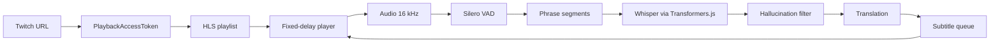

subany.video is a small experiment with a deliberately narrow promise: paste a Twitch link and watch the stream with translated subtitles. No account, no installation, no extension. The video, the speech recognition and the translation all run in the browser.

That promise is also the design constraint. Every technical decision below is subordinate to it: if a feature made the "paste and watch" path slower or more fragile, it stayed out. The result is not a general-purpose transcription platform. It is a player that deliberately runs a few seconds behind the live edge so that it has enough audio to recognise, translate and display complete phrases.

This article walks through the parts that make that work. The code excerpts come from the phase-0 prototype, which lives in a private repository at the time of writing.

## What it is and what constraint rules

The input is a Twitch channel URL. The output is the same stream in a custom HLS player, with subtitles in the viewer's language.

Three properties matter more than anything else:

- **No account.** The viewer never signs in, and the product never asks for one.
- **No install.** Everything ships as a web page.
- **Local processing.** Audio is transcribed and translated on the viewer's machine, using WebGPU when it is available and the CPU otherwise.

The prototype supports a fixed delay of 10, 15 or 20 seconds, with 15 seconds as the default. That delay is the central trade-off: it is the room the system needs to turn a live audio stream into readable, synchronised text.

## Architecture at a glance

The pipeline has two halves. One half keeps a delayed HLS stream playing; the other turns the audio that has already been buffered into subtitles and feeds them back to the player.



The player and the worker are intentionally separate. The player owns video timing; the worker owns the audio pipeline. A subtitle is created with the real start and end time of its phrase, so it can be shown against the delayed video without a second clock.

## The fixed-delay player

A live HLS playlist does not keep the whole stream. In the phase-0 measurements, Twitch kept roughly **28–30 seconds** of video available. Waiting for a 15-second delay would waste most of that window and make startup slow, so the player normally jumps backwards as soon as it has enough buffer. If the available window is too short for that jump, it falls back to pausing and accumulating the delay.

The hls.js configuration follows the target delay directly:

```ts
// src/reproductor/retraso.ts
export function configHls(objetivoSeg: number) {
  return {
    liveSyncDuration: objetivoSeg,
    liveMaxLatencyDuration: objetivoSeg + 20,
    maxLiveSyncPlaybackRate: 1,          // never speed up to catch the live edge
    maxBufferLength: objetivoSeg * 2,
    lowLatencyMode: false,
  };
}
```

`maxLiveSyncPlaybackRate: 1` is deliberate. hls.js can normally play slightly faster to recover from latency, but speeding up the video would break the relationship between the audio and the subtitles that were timed against it. The player stays at normal speed and corrects its position in jumps instead.

A jump is only allowed when the delay has drifted more than two seconds past the target:

```ts
// src/reproductor/retraso.ts
export function debeResincronizar(latenciaSeg: number, objetivoSeg: number, margenSeg = 2): boolean {
  return latenciaSeg > objetivoSeg + margenSeg;
}
```

The controller samples the latency every five seconds. If the tab is hidden and Chrome pauses a muted video, the delay can grow to 29–31 seconds; when the viewer comes back, the player seeks to the live edge minus the target delay. The check is skipped while the tab is hidden so the player does not fight the browser's pause behaviour.

At startup there are two modes. `saltar` is the fast path described above: enough history exists, so the player seeks back immediately. `acumular` pauses playback while hls.js keeps loading until the target latency is reached. The choice is a one-line decision:

```ts
// src/reproductor/retraso.ts
export function planificarRetraso(ventanaSeg: number, objetivoSeg: number, margenSeg = 2): 'saltar' | 'acumular' {
  return ventanaSeg >= objetivoSeg + margenSeg ? 'saltar' : 'acumular';
}
```

## Getting access to a Twitch live stream

Twitch does not expose a simple public playback URL. The prototype follows the same path as the official web player:

1. Request a `PlaybackAccessToken` from Twitch's GQL endpoint.
2. Build an HLS master playlist URL on `usher.ttvnw.net` with that token.
3. Read the variant playlists and media segments from Twitch's CDN.

The token request uses the public web Client-ID and a persisted GQL query. This part works from any origin because GQL returns permissive CORS headers. The master playlist is different: `usher.ttvnw.net` only allows `twitch.tv`, and the audio/video variant playlists return **403** to a public third-party origin. Media segments, on the other hand, are downloadable with CORS `*`.

That asymmetry motivates the minimal proxy. It only forwards text playlists — a few kilobytes every couple of seconds per viewer. Video and audio never pass through it. The prototype has three access modes: `directo` when the browser can reach everything, `proxy-listas` when only the lists need the intermediary, and `proxy-todo` when the token request also has to go through it.

```ts
// src/twitch/acceso.ts
export function urlMaestra(canal: string, token: { valor: string; firma: string }, via: ViaAcceso): string {
  const u = new URL(`https://usher.ttvnw.net/api/v2/channel/hls/${canal.toLowerCase()}.m3u8`);
  const p: Record<string, string> = {
    platform: 'web',
    p: String(Math.floor(Math.random() * 999999)),
    allow_source: 'true',
    allow_audio_only: 'true',
    playlist_include_framerate: 'true',
    multigroup_video: 'true',
    supported_codecs: 'h264',
    sig: token.firma,
    token: token.valor,
    fast_bread: 'true',
  };
  for (const [k, v] of Object.entries(p)) u.searchParams.set(k, v);
  return via === 'directo' ? u.href : `${PROXY}/hls?u=${encodeURIComponent(u.href)}`;
}
```

The playlists contain the viewer's IP and the token is signed, so the prototype never stores either. The proxy exists to satisfy CORS, not to become a media server.

This is also the most fragile part of the product. During phase 0, Twitch changed the master playlist format (the `STABLE-VARIANT-ID` / `IVS-NAME` fields), and two of twenty tested channels already served audio as fMP4/CMAF. Any production version has to treat the Twitch adapter as a moving target.

## Voice to phrases: Silero VAD

Whisper works best on complete phrases, not on an endless stream. The first job is therefore to find speech and cut it into phrases.

Audio is resampled to **16 kHz**. The voice activity detector is **Silero VAD v5**, running as an ONNX model through `onnxruntime-web` on the CPU. Each inference consumes a frame of **512 samples**, which is **32 ms** at 16 kHz, and carries a recurrent state of shape `[2, 1, 128]`:

```ts
// src/directo/vad.ts
async probabilidad(trama: Float32Array /* 512 samples at 16 kHz */): Promise<number> {
  const r = await this.sesion!.run({
    input: new ort.Tensor('float32', trama, [1, 512]),
    state: new ort.Tensor('float32', this.estado, [2, 1, 128]),
    sr: this.sr,
  });
  this.estado = Float32Array.from(r.stateN.data as Float32Array);
  return (r.output.data as Float32Array)[0];
}
```

The VAD only produces a probability per frame. The segmenter turns that sequence into phrases with a small state machine:

- A phrase starts when the probability reaches **0.5**.
- It closes after **500 ms** of consecutive frames below **0.35**.
- The end is the last frame that still had voice, not the end of the silence.
- Phrases shorter than **250 ms** are dropped.
- A phrase that reaches **8 seconds** is cut at the lowest-probability frame in the last **3 seconds**, provided that frame is below 0.35; otherwise it is cut at exactly 8 seconds.

```ts
// src/directo/segmentador.ts
export const TRAMA_MS = 32, UMBRAL_INICIO = 0.5, UMBRAL_FIN = 0.35,
  SILENCIO_FIN_MS = 500, MIN_FRASE_MS = 250, MAX_FRASE_MS = 8000, VENTANA_PAUSA_MS = 3000;

// A phrase opens at >= 0.5 and closes after 500 ms below 0.35.
// At 8 s it is cut at the quietest frame of the last 3 s, or at 8 s exactly.
```

This is a simple design on purpose. It does not try to identify sentences semantically; it finds pauses. The 8-second ceiling keeps the later Whisper step inside its latency budget, and the quietest-frame cut avoids slicing in the middle of a loud syllable whenever the audio offers a better boundary.

## Whisper in the browser

Transcription uses **Transformers.js** with ONNX versions of Whisper. The catalogue covers five sizes: `whisper-tiny`, `whisper-base`, `whisper-small`, `whisper-large-v3-turbo` and `whisper-large-v3`. On WebGPU the encoder runs in **fp16** and the decoder in **q4** (if the GPU does not expose shader-f16, the encoder falls back to fp32). On the CPU path the models run in **q8**.

Live phrases are short, so the transcriptor caps output tokens according to duration:

```ts
// src/modelos/transcriptor.ts
export function maxTokensPara(muestras: number): number {
  return Math.min(440, Math.max(16, Math.ceil((muestras / 16000) * 10)));
}
```

Ten tokens per second is roughly three times the normal speech rate. A real phrase fits comfortably, while a Whisper loop — the classic "hola hola hola…" — is cut before it reaches the 448-token ceiling and ruins the latency. The same function is applied to short clips in the collection benchmark.

Longer audio takes a different path. Anything over 30 seconds is transcribed with a **30-second chunk** and a **5-second stride**, so the model sees overlapping context instead of one endless window:

```ts
// src/modelos/transcriptor.ts
if (m.length > 30 * 16000) Object.assign(opciones, { chunk_length_s: 30, stride_length_s: 5 });
else opciones.max_new_tokens = maxTokensPara(m.length);
```

Two safeguards sit around the model. First, the worker drops empty output and text rejected by a hallucination filter. Second, the worker **warms up** the model before announcing that it is ready: it transcribes one second of silence, so the first real phrase does not pay the cost of compiling GPU shaders. When an external translator is used, it is warmed up with a short translation as well.

## Translation

Translation is pluggable because no single option fits every browser and every machine. The prototype supports four families:

- **The browser's built-in Translator API.** Fast (around 30 ms per phrase in the phase-0 tests) and available in Chrome, Brave and Opera GX, but not Firefox. It does not exist inside Web Workers, so the worker sends the text to the page, the page translates it, and the result comes back.
- **Opus-MT.** Commercial (CC-BY-4.0), around 450 MB in fp32 or 230 MB in q8. A direct source-to-target pair is used when an ONNX model exists; otherwise the text is pivoted through English.
- **NLLB-600M.** Good quality in the blind comparison, but **non-commercial** (CC-BY-NC-4.0), so it is a research option rather than a product option.
- **Qwen3 0.6B, 1.7B and 4B.** Commercial (Apache-2.0). The 4B model scored slightly better than the others but takes about 1.3 seconds per phrase and occasionally emitted Chinese characters; the 1.7B model did not load on the test laptop.

The pivot through English is explicit in the catalogue. If a direct Opus-MT model for the source language is missing, the translator loads two pipelines and runs the text through both:

```ts
// src/modelos/catalogo.ts
export function candidatoOpus(origen: string): CandidatoTraduccion {
  const directa = `Xenova/opus-mt-${origen}-es`;
  const modelos = CATALOGO.some(e => e.id === directa)
    ? [directa]
    : [`Xenova/opus-mt-${origen}-en`, 'Xenova/opus-mt-en-es'];
  return { nombre: 'opus-mt', tipo: 'opus', modelos, licencia: 'comercial' };
}
```

In the phase-0 blind comparison (scored 0–1 by Claude, not by human reviewers), the built-in translator and NLLB-600M both scored **0.57**, Qwen3-4B scored **0.59**, and Opus-MT scored **0.44**. Those numbers are useful for choosing a default, not for claiming human-level translation quality.

## Subtitle timing

Once a phrase has text and a translation, the worker builds a subtitle with the phrase's original start and end times. The player can then display it at the right moment against the delayed video.

Admission is a three-way decision based on when the subtitle became ready:

```ts
// src/directo/subtitulos.ts
export type Admision = 'a-tiempo' | 'tarde-mostrado' | 'tarde-descartado';

export function admitirSubtitulo(s: Subtitulo, ahoraMs: number): Admision {
  if (ahoraMs <= s.inicio) return 'a-tiempo';
  return s.fin - ahoraMs >= 1000 ? 'tarde-mostrado' : 'tarde-descartado';
}
```

If the subtitle is ready before its phrase starts, it is on time. If it is late but at least one second of the phrase remains, it is shown late. If less than a second remains, it is discarded rather than flashed on screen. A counter records the three outcomes and reports the proportion that arrived on time.

Lines are wrapped at **42 characters**, without summarising or rewriting the translation:

```ts
// src/directo/subtitulos.ts
export function partirLineas(texto: string, maxCaracteres = 42): string[] {
  const lineas: string[] = [];
  let actual = '';
  for (const p of texto.split(/\s+/).filter(Boolean)) {
    if (actual && actual.length + 1 + p.length > maxCaracteres) { lineas.push(actual); actual = p; }
    else actual = actual ? `${actual} ${p}` : p;
  }
  if (actual) lineas.push(actual);
  return lineas;
}
```

The worker is a single loop: VAD frames become phrases, phrases are transcribed, hallucinated output is dropped, the rest is translated, and a subtitle is posted back to the page. The page never blocks on transcription; it keeps playing video while the worker catches up.

## Privacy and resources

The privacy story is simple because the architecture is local. Audio is decoded and resampled in the browser, the VAD runs in WASM, Whisper runs in WebGPU or WASM, and translation runs either in the browser's own translator or in a local ONNX model. Audio never leaves the machine. The browser still talks to Twitch for the token and playlists — directly or through the minimal proxy — and downloads model files from Hugging Face on first use.

Models are downloaded from Hugging Face on first use and cached by the browser. That cache explains the two very different startup numbers: with the models already present, the first subtitle appeared **11–13 seconds** after pressing play; on a cold profile, the first visit took **66–108 seconds** because the models had to download.

The compute path matters as much as the network. WebGPU handles the larger models comfortably on a dedicated GPU. WASM is the fallback, and it is slower: Firefox's WebGPU implementation measured **4–8 times slower** than Chrome's in phase 0, which is why the basic tier uses `whisper-base` on the CPU rather than pretending the GPU path is universal. Firefox with the CPU path still delivered 100% of subtitles on time in the phase-0 test.

There is no account system, so there is no server-side profile, history or identity to protect. The trade-off is that the product cannot sync settings across devices, and any future multi-user feature would need a separate design.

## Real measurements

The phase-0 report measured the prototype on a Windows laptop with a Ryzen CPU, 16 GB of RAM and an AMD RX 5600M GPU. These are the numbers that decided whether the project continued:

| Metric | Result |
|---|---|
| Fixed delay | 15.27–15.62 s with a 15 s target |
| HLS window | 28–30 s |
| Median subtitle offset | 0–40 ms |
| High tier on time | 99.0%, 100%, 100% across three channels |
| First subtitle | 11–13 s with cache; 66–108 s on a first visit |
| Speaker-turn accuracy | 56% |

The delay stayed inside ±1 second across ten-minute runs at 10, 15 and 20 seconds. The subtitle offset is the difference between the audio being heard and the timestamp of the phrase it belongs to; a deliberately injected 300 ms offset was detected exactly. The on-time percentages come from three channels at the high tier and cleared the 95% target.

## Limits and next steps

The honest list is longer than the feature list:

- **Speaker diarisation is not solved.** The prototype identifies who is speaking correctly in **56%** of turns, against an 85% target. Voice fingerprints separate speakers well enough to be a foundation, but the live product does not yet use them to label subtitles.
- **The first visit is slow.** Downloading models takes 66–108 seconds. Starting with a small model and switching to a larger one when it arrives is the obvious next step.
- **Mobile is unmeasured.** The phase-0 benchmark was a Windows laptop; mobile browsers and their thermal limits were not part of it.
- **NLLB is non-commercial.** It stays out of the public product unless the licence changes or a commercial alternative reaches the same quality.
- **Twitch access is fragile.** The master playlist format changed during phase 0, and fMP4/CMAF audio is already appearing on some channels.
- **There are no accounts by design.** That keeps the product simple, but it also means no saved preferences and no cross-device continuity.

None of these invalidate the core result: a browser can keep a delayed live stream stable, transcribe it locally, translate it, and show subtitles on time without a server-side GPU.

## Try it

The public entry point is [subany.video](https://subany.video/). There is also a project page with the short version: [subany.video project page](/projects/subany-video/).

Paste a Twitch link, pick a delay, and watch the first subtitles arrive. If the models are not cached yet, the first minute is the download; after that, the browser is doing the work.
