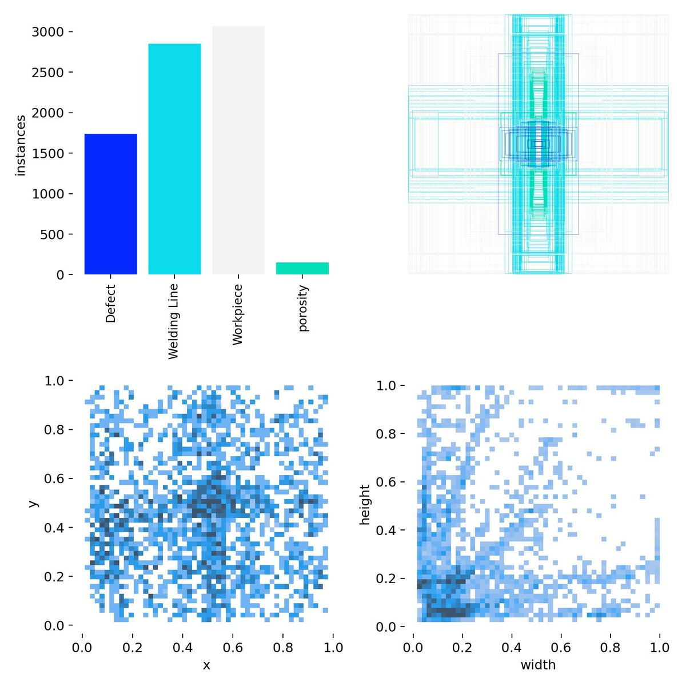
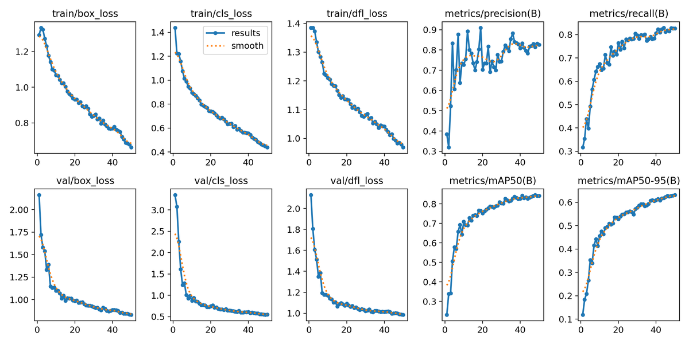
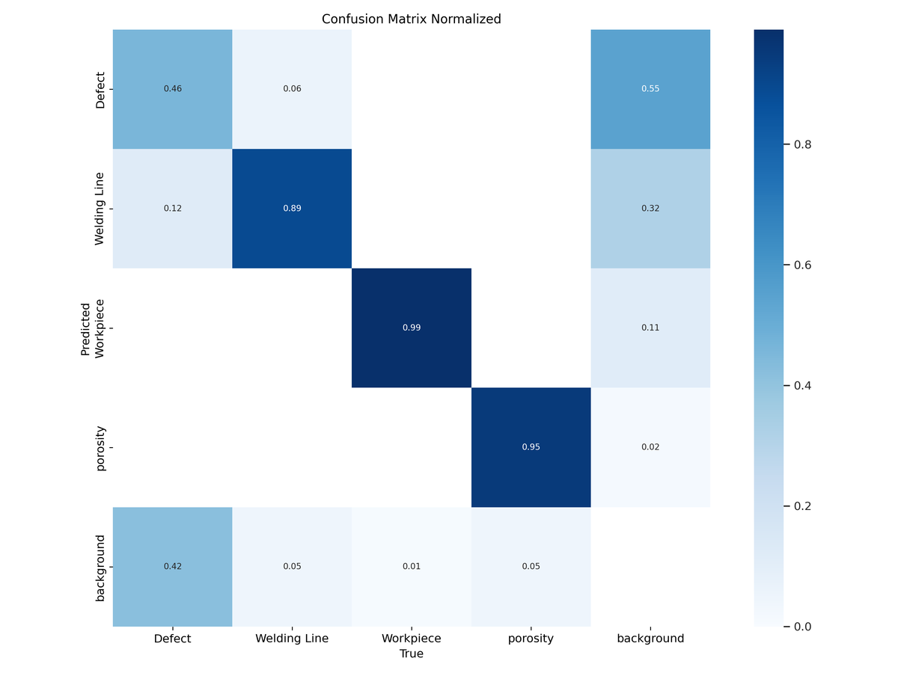
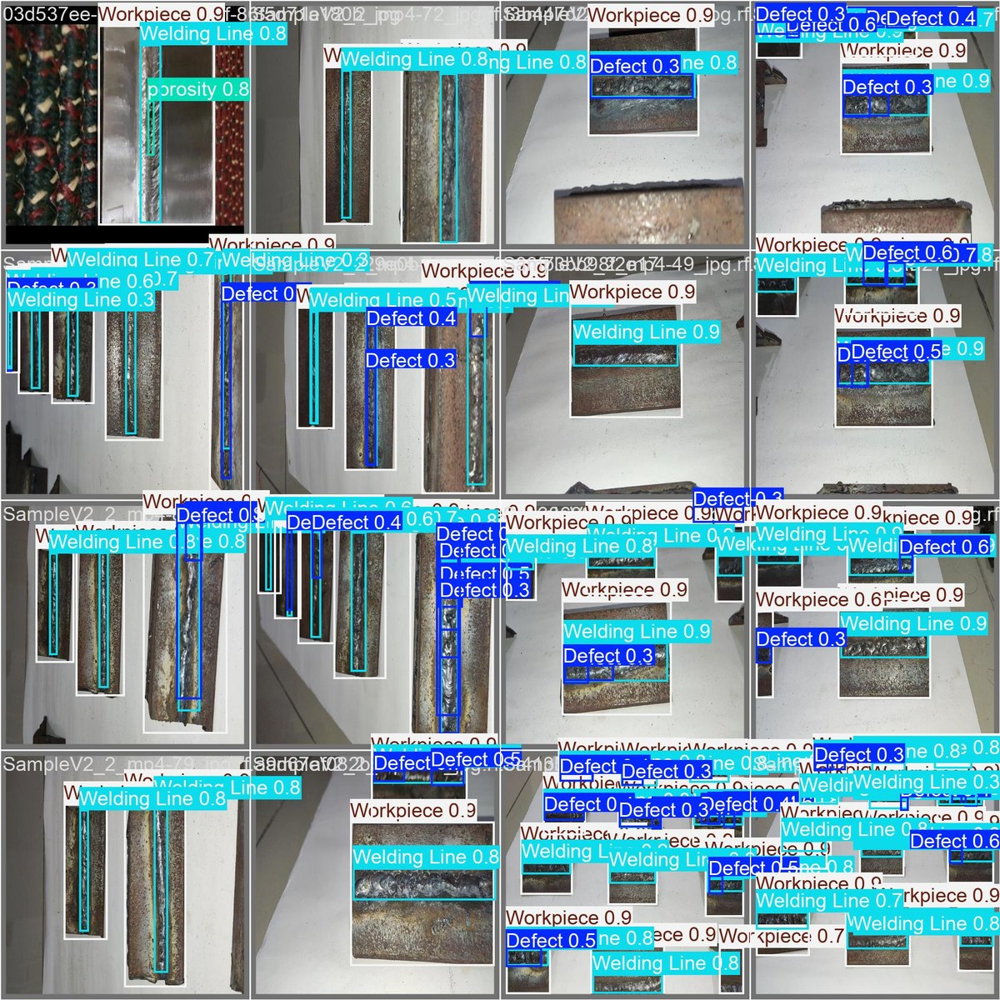


Weld inspection is a textbook industrial computer-vision problem. An inspector looks at a seam, finds the weld bead and the base metal, spots any surface anomaly and decides whether the part passes. The first three steps are perception; the last one is a standards question.

This project trains a **YOLO11x** detector to do the perception part: localise the weld line, the workpiece, porosity and generic defects in a single pass. It is a research prototype, not a certified inspection system, but the validation report is honest enough to be useful.

## What the model actually sees

Four classes, in this order:

| ID | Class | Meaning |
|:--:|---|---|
| 0 | `Defect` | Generic weld defect |
| 1 | `Welding Line` | Weld bead / seam |
| 2 | `Workpiece` | Base metal part |
| 3 | `porosity` | Porosity |

The checkpoint is deliberately large: **56.8 M parameters and 194.4 GFLOPs**. For offline or semi-automated inspection, accuracy is worth more than the last few milliseconds of latency. A smaller variant makes sense only after the dataset matures.



## The numbers, and what they mean

On a validation split of **116 images / 773 instances**:

| Class | Precision | Recall | mAP@50 | mAP@50-95 |
|---|---:|---:|---:|---:|
| **all** | **0.826** | **0.827** | **0.842** | **0.632** |
| `Defect` | 0.552 | 0.427 | 0.445 | 0.202 |
| `Welding Line` | 0.873 | 0.966 | 0.966 | 0.679 |
| `Workpiece` | 0.941 | 0.987 | 0.992 | 0.938 |
| `porosity` | 0.939 | 0.927 | 0.965 | 0.710 |



The headline **0.842 mAP@50** is carried by the structural classes. `Workpiece` (0.992) and `Welding Line` (0.966) are almost solved; `porosity` (0.965) is surprisingly strong. The generic `Defect` class reaches only **0.445 mAP@50** and **0.427 recall** — it groups cracks, undercuts, spatter and lack-of-fusion, which look nothing alike. That is the real research problem, not the architecture.



A second caveat: 116 validation images is small. These numbers are a baseline for further work, not a production acceptance test.

## Demo: sample predictions

These are validation predictions from the published checkpoint, not live inference:



The boxes on the seam and the part are the model's localisation output. To run the model yourself, the weights live on a gated Hugging Face model card — accept its conditions and authenticate first:

```bash
hf download jparedesDS/welding-defects-detection \
  welding_defects_yolo11x.pt --local-dir weights
```

```python
from ultralytics import YOLO

model = YOLO("weights/welding_defects_yolo11x.pt")
results = model.predict("weld.jpg", conf=0.25, save=True, device=0)

for box in results[0].boxes:
    print(model.names[int(box.cls)], float(box.conf), box.xyxy.tolist())
```

[Open the model on Hugging Face](https://huggingface.co/jparedesDS/welding-defects-detection) · [Read the full project in the model zoo](https://github.com/jparedesDS/object-detection-models/tree/main/projects/welding-defects-detection)

## From boxes to an inspection decision

The detector emits boxes, not verdicts. A usable pipeline adds four steps:

1. **Region filtering** — keep defect boxes that fall on or near the detected `Welding Line`.
2. **Size measurement** — convert box dimensions to millimetres with a calibrated capture rig.
3. **Rule engine** — compare defect type and size with the applicable acceptance standard.
4. **Human review** — route borderline or low-confidence cases to a qualified inspector.

Standards such as ISO 5817, ASME IX or AWS D1.1 define acceptance; a neural network does not. The model only makes the inspector faster.

## What is next

- Split `Defect` into cracks, undercuts, spatter and lack-of-fusion, and collect more examples per type.
- Add pixel-level segmentation for defect sizing.
- Calibrate distance, angle and lighting so box sizes mean something physical.
- Validate against one specific standard and process before claiming readiness.

The original repository is archived; the code, notebook and evaluation now live in the [object-detection-models](https://github.com/jparedesDS/object-detection-models) zoo. MIT licensed.



La inspección de soldaduras es un problema clásico de visión artificial industrial. Un inspector mira la costura, localiza el cordón y el metal base, detecta cualquier anomalía superficial y decide si la pieza pasa. Los tres primeros pasos son percepción; el último es una cuestión de normativa.

Este proyecto entrena un detector **YOLO11x** para la parte de percepción: localizar en una sola pasada la línea de soldadura, la pieza, la porosidad y los defectos genéricos. Es un prototipo de investigación, no un sistema de inspección certificado, pero el informe de validación es suficientemente honesto para servir de base.

## Lo que ve realmente el modelo

Cuatro clases, en este orden:

| ID | Clase | Significado |
|:--:|---|---|
| 0 | `Defect` | Defecto genérico de soldadura |
| 1 | `Welding Line` | Cordón / costura |
| 2 | `Workpiece` | Pieza de metal base |
| 3 | `porosity` | Porosidad |

El checkpoint es deliberadamente grande: **56,8 M de parámetros y 194,4 GFLOPs**. En inspección offline o semiautomática, la precisión vale más que los últimos milisegundos de latencia. Una variante más pequeña tendrá sentido cuando el dataset madure.


## Las cifras y lo que significan

Sobre una partición de validación de **116 imágenes / 773 instancias**:

| Clase | Precisión | Recall | mAP@50 | mAP@50-95 |
|---|---:|---:|---:|---:|
| **todas** | **0,826** | **0,827** | **0,842** | **0,632** |
| `Defect` | 0,552 | 0,427 | 0,445 | 0,202 |
| `Welding Line` | 0,873 | 0,966 | 0,966 | 0,679 |
| `Workpiece` | 0,941 | 0,987 | 0,992 | 0,938 |
| `porosity` | 0,939 | 0,927 | 0,965 | 0,710 |


El titular **0,842 mAP@50** lo sostienen las clases estructurales. `Workpiece` (0,992) y `Welding Line` (0,966) están casi resueltas; `porosity` (0,965) funciona sorprendentemente bien. La clase genérica `Defect` se queda en **0,445 mAP@50** y **0,427 de recall**: agrupa grietas, socavaduras, salpicaduras y falta de fusión, que no se parecen entre sí. Ese es el verdadero problema de investigación, no la arquitectura.


Segunda advertencia: 116 imágenes de validación son pocas. Estas cifras son una línea base para seguir trabajando, no un ensayo de aceptación industrial.

## Demo: predicciones de ejemplo

Estas son predicciones de validación del checkpoint publicado, no inferencia en directo:


Las cajas sobre la costura y la pieza son la salida de localización del modelo. Para ejecutarlo tú mismo, los pesos están en una tarjeta de modelo restringida de Hugging Face: acepta las condiciones y autentícate primero:

```bash
hf download jparedesDS/welding-defects-detection \
  welding_defects_yolo11x.pt --local-dir weights
```

```python
from ultralytics import YOLO

model = YOLO("weights/welding_defects_yolo11x.pt")
results = model.predict("weld.jpg", conf=0.25, save=True, device=0)

for box in results[0].boxes:
    print(model.names[int(box.cls)], float(box.conf), box.xyxy.tolist())
```

[Abrir el modelo en Hugging Face](https://huggingface.co/jparedesDS/welding-defects-detection) · [Ver el proyecto completo en el zoo](https://github.com/jparedesDS/object-detection-models/tree/main/projects/welding-defects-detection)

## De cajas a una decisión de inspección

El detector emite cajas, no veredictos. Un flujo usable añade cuatro pasos:

1. **Filtro por región** — conservar las cajas de defecto que caen sobre o cerca de la `Welding Line` detectada.
2. **Medición de tamaño** — convertir las dimensiones de la caja a milímetros con una captura calibrada.
3. **Motor de reglas** — comparar tipo y tamaño de defecto con la norma de aceptación aplicable.
4. **Revisión humana** — enviar los casos dudosos o de baja confianza a un inspector cualificado.

Normas como ISO 5817, ASME IX o AWS D1.1 definen la aceptación; una red neuronal no. El modelo solo hace más rápido al inspector.

## Lo siguiente

- Separar `Defect` en grietas, socavaduras, salpicaduras y falta de fusión, y recoger más ejemplos de cada tipo.
- Añadir segmentación a nivel de píxel para medir defectos.
- Calibrar distancia, ángulo e iluminación para que el tamaño de las cajas tenga significado físico.
- Validar contra una norma y un proceso concretos antes de hablar de despliegue.

El repositorio original está archivado; el código, el notebook y la evaluación viven ahora en el [model zoo de object-detection-models](https://github.com/jparedesDS/object-detection-models). Licencia MIT.

