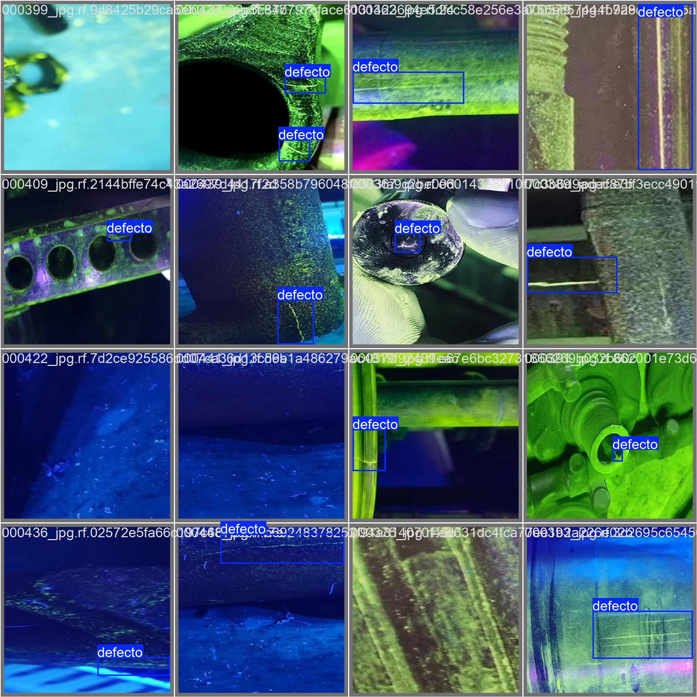
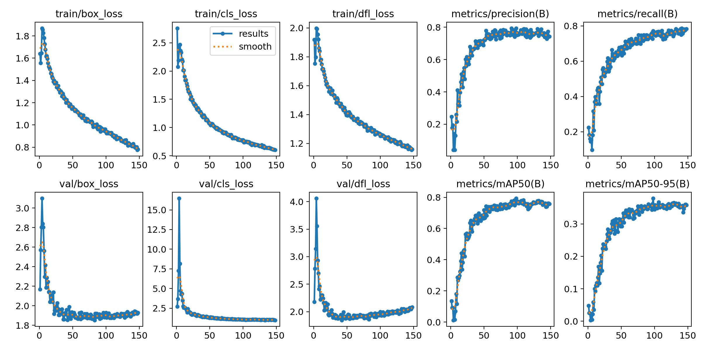
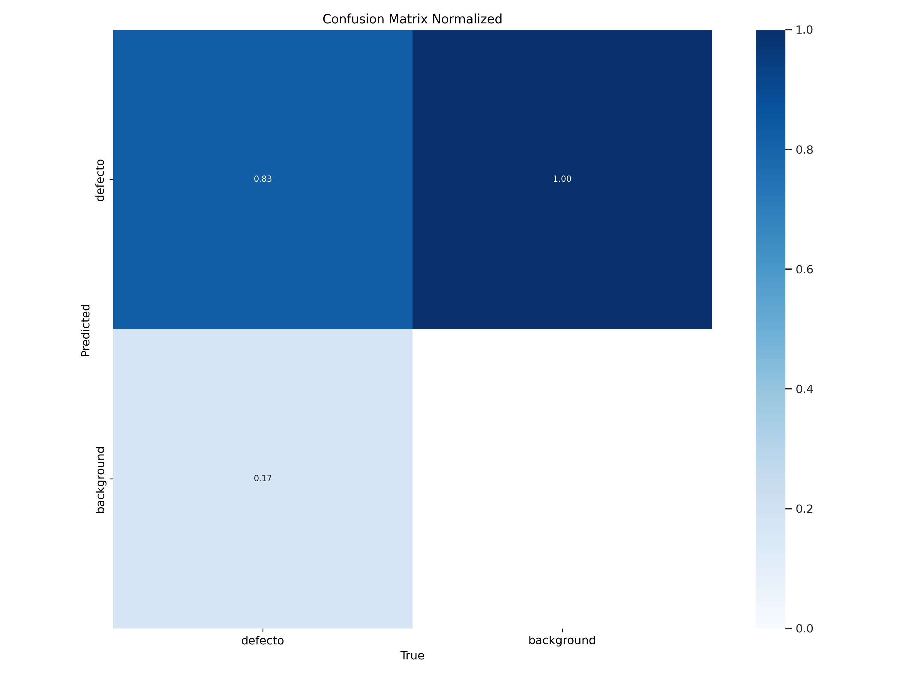


Liquid penetrant inspection is one of those non-destructive tests that looks simple until you try to automate it. A penetrant is applied to a part, the excess is removed, a developer draws anything trapped in a surface-breaking discontinuity back out, and an inspector looks for the resulting indications — under UV light in the fluorescent variant (FPI / PT / LPI).

The visual signal is distinctive: a bright fluorescent glow on a dark surface. It is also a difficult one for a detector. The glow bleeds beyond the actual discontinuity, reflections and glare are everywhere, and illumination is rarely even across a curved part.

This project trains a **single-class YOLO11l detector** to localise those indications. It is a research prototype, not a certified inspection system: the qualification of the procedure, the personnel and the acceptance criteria stays with the responsible NDT organisation.

## The question the model answers

One class, `defecto`, because the first useful question in penetrant inspection is *is there an indication here, and where?* The model does not classify the defect type and it does not measure depth.

| Property | Value |
|---|---|
| Architecture | YOLO11l |
| Checkpoint | `yolo11l_LPI.pt` |
| Parameters | 25.3 M |
| GFLOPs | 86.6 |
| Classes | 1 (`defecto`) |
| Validation split | 836 images / 752 instances |
| mAP@50 | **0.793** |
| mAP@50-95 | **0.379** |

YOLO11l is a deliberate middle ground: enough capacity for a subtle, low-contrast signal without paying for an extra-large checkpoint. The repo reports 25.3 M parameters and 86.6 GFLOPs, roughly half the compute of the YOLO11x used in the [welding detector](/en/blog/2026/11/23/welding-defects-detection/).

## Why the data is awkward

The validation split has 836 images but only 752 annotated indications. Many frames contain no defect at all. That is realistic — most inspected parts are good — but it means a detector can look accurate by simply staying quiet.

The confounders are physical, not stylistic: glare from the UV source, surface reflections, developer texture, part geometry and exposure changes. Augmentation cannot manufacture a representative set of those effects; they have to be collected.

## The numbers, and what they mean

| Class | Precision | Recall | mAP@50 | mAP@50-95 |
|---|---:|---:|---:|---:|
| all | 0.794 | 0.771 | 0.793 | 0.379 |

At IoU 0.50 the detector is genuinely useful: it finds about three quarters of the indications it should, and most of its alarms are real. The suspicious part is the drop to 0.379 when the IoU threshold is raised.

That gap is not a training bug. A fluorescent indication glows: the visible region is larger and softer than the discontinuity that produced it. A box drawn around what the inspector sees will not tightly fit the physical defect. So **mAP@50-95 is measuring something the model was never asked to do** — precise sizing — while mAP@50 measures the task it was trained for: flagging suspicious regions.

If the goal is triage, 0.793 mAP@50 is a reasonable starting point. If the goal is to measure an indication in millimetres and compare it with an acceptance standard, this checkpoint is not enough.

## From boxes to an inspection decision

The detector returns boxes, never pass/fail. A practical pipeline needs five more pieces:

1. **Illumination control** — fixed UV source, exposure and camera distance.
2. **Region filtering** — ignore reflections, fixture edges and known non-defect areas.
3. **Size measurement** — convert box dimensions to millimetres with a calibrated scale.
4. **Rule engine** — compare size and location with the applicable acceptance criteria.
5. **Human review** — route every detection to a qualified inspector until the system is validated.

This is the same gap identified at the end of the welding post: perception is solvable with a detector, but a decision requires calibration and a standard.

## What is next

- Add a calibration target so box sizes mean physical units.
- Separate true indications from reflections with a second class or a post-processing rule.
- Collect more examples per defect type and per material.
- Evaluate at IoU 0.50 and with a size-aware criterion instead of mAP@50-95 alone.
- Validate the complete procedure against a specific NDT standard.

The dataset is not distributed. The Hugging Face model is gated: accept the conditions on the model card and authenticate with `hf auth login` before downloading. Code, notebook and evaluation live in the [object-detection-models](https://github.com/jparedesDS/object-detection-models/tree/main/projects/fluorescent-penetrant-inspection) zoo; the weights are on [Hugging Face](https://huggingface.co/jparedesDS/fluorescent-penetrant-inspection). MIT licensed.




La inspección con líquidos penetrantes es uno de esos ensayos no destructivos que parece sencillo hasta que intentas automatizarlo. Se aplica un penetrante a la pieza, se retira el exceso, un revelador extrae lo que haya quedado atrapado en una discontinuidad abierta a superficie y el inspector busca las indicaciones resultantes, bajo luz UV en la variante fluorescente (FPI / PT / LPI).

La señal visual es característica: un brillo fluorescente sobre una superficie oscura. También es difícil para un detector. El brillo se extiende más allá de la discontinuidad real, los reflejos y el deslumbramiento están por todas partes y la iluminación rara vez es uniforme en una pieza curva.

Este proyecto entrena un **detector YOLO11l de una sola clase** para localizar esas indicaciones. Es un prototipo de investigación, no un sistema de inspección certificado: la cualificación del procedimiento, del personal y de los criterios de aceptación sigue siendo responsabilidad de la organización NDT.

## La pregunta que responde el modelo

Una sola clase, `defecto`, porque la primera pregunta útil en esta inspección es *¿hay una indicación aquí y dónde está?* El modelo no clasifica el tipo de defecto ni mide su profundidad.

| Propiedad | Valor |
|---|---|
| Arquitectura | YOLO11l |
| Checkpoint | `yolo11l_LPI.pt` |
| Parámetros | 25,3 M |
| GFLOPs | 86,6 |
| Clases | 1 (`defecto`) |
| División de validación | 836 imágenes / 752 instancias |
| mAP@50 | **0,793** |
| mAP@50-95 | **0,379** |

YOLO11l es un término medio deliberado: capacidad suficiente para una señal sutil y de poco contraste sin pagar por un checkpoint extra-grande. El repositorio reporta 25,3 M de parámetros y 86,6 GFLOPs, aproximadamente la mitad de cómputo que el YOLO11x del [detector de soldadura](/en/blog/2026/11/23/welding-defects-detection/).

## Por qué los datos son incómodos

La división de validación tiene 836 imágenes pero solo 752 indicaciones anotadas. Muchos fotogramas no contienen ningún defecto. Es realista — la mayoría de las piezas inspeccionadas son buenas — pero significa que un detector puede parecer preciso limitándose a callar.

Los factores de confusión son físicos, no estilísticos: deslumbramiento de la fuente UV, reflejos en la superficie, textura del revelador, geometría de la pieza y cambios de exposición. La augmentación no puede fabricar un conjunto representativo de esos efectos; hay que recolectarlos.

## Las cifras y lo que significan

| Clase | Precisión | Recall | mAP@50 | mAP@50-95 |
|---|---:|---:|---:|---:|
| todas | 0,794 | 0,771 | 0,793 | 0,379 |

Con IoU 0,50 el detector es realmente útil: encuentra aproximadamente tres cuartas partes de las indicaciones que debería y la mayoría de sus alarmas son reales. Lo sospechoso es la caída a 0,379 al subir el umbral de IoU.

Esa diferencia no es un error de entrenamiento. Una indicación fluorescente brilla: la región visible es mayor y más difusa que la discontinuidad que la produjo. Una caja dibujada alrededor de lo que ve el inspector no se ajusta con precisión al defecto físico. Por tanto, **mAP@50-95 está midiendo algo que nunca se le pidió al modelo** — medir con precisión — mientras que mAP@50 mide la tarea para la que se entrenó: marcar regiones sospechosas.

Si el objetivo es cribado, 0,793 de mAP@50 es un punto de partida razonable. Si el objetivo es medir una indicación en milímetros y compararla con una norma de aceptación, este checkpoint no basta.

## De cajas a una decisión de inspección

El detector devuelve cajas, nunca un resultado de apto/no apto. Un pipeline práctico necesita cinco piezas más:

1. **Control de iluminación** — fuente UV, exposición y distancia de cámara fijas.
2. **Filtrado de regiones** — ignorar reflejos, bordes de utillaje y zonas conocidas sin defecto.
3. **Medición de tamaño** — convertir las dimensiones de la caja a milímetros con una escala calibrada.
4. **Motor de reglas** — comparar tamaño y posición con los criterios de aceptación aplicables.
5. **Revisión humana** — enviar cada detección a un inspector cualificado hasta validar el sistema.

Es la misma distancia que señalaba el final del post de soldadura: la percepción se resuelve con un detector, pero una decisión exige calibración y una norma.

## Lo siguiente

- Añadir un patrón de calibración para que el tamaño de las cajas signifique unidades físicas.
- Separar indicaciones reales de reflejos con una segunda clase o una regla de postprocesado.
- Recolectar más ejemplos por tipo de defecto y por material.
- Evaluar con IoU 0,50 y un criterio dependiente del tamaño en lugar de solo mAP@50-95.
- Validar el procedimiento completo frente a una norma NDT concreta.

El dataset no se distribuye. El modelo en Hugging Face está restringido: acepta las condiciones de la ficha y autentícate con `hf auth login` antes de descargarlo. El código, el notebook y la evaluación están en el [zoo object-detection-models](https://github.com/jparedesDS/object-detection-models/tree/main/projects/fluorescent-penetrant-inspection); los pesos, en [Hugging Face](https://huggingface.co/jparedesDS/fluorescent-penetrant-inspection). Licencia MIT.


