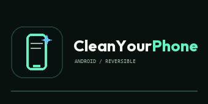

+++
title = "Projects"
translationKey = "projects"
user = "projects"
showMetadata = false
+++

Nine projects, each with an image, a short explanation and its links. Everything here is live or in production.

<section class="projectRow">

<h3>Industrial computer vision</h3>

YOLO11 detectors for fluorescent penetrant indications and welding defects, published as 10+ models on Hugging Face and used in real inspection work.

<ul class="projectChips"><li>YOLO11</li><li>Hugging Face</li><li>Production</li></ul>

<a href="https://huggingface.co/jparedesDS/fluorescent-penetrant-inspection" target="_blank" rel="noopener noreferrer">Penetrant model</a><a href="https://huggingface.co/jparedesDS" target="_blank" rel="noopener noreferrer">More models</a><a href="https://github.com/jparedesDS/welding-defects-detection" target="_blank" rel="noopener noreferrer">Welding detector</a>

</section>

<section class="projectRow">

<h3>DocFlow — document control</h3>

Internal SaaS built end to end: a FastAPI backend with 21 routers and 24 services, a React frontend with 24 screens, DocuSign signatures and Docker + CI deployment. The public repository is DocFlow Lite.

<ul class="projectChips"><li>FastAPI</li><li>React</li><li>DocuSign</li><li>Docker</li></ul>

<a href="https://github.com/jparedesDS/docflow" target="_blank" rel="noopener noreferrer">DocFlow Lite on GitHub</a>

</section>

<section class="projectRow">

<h3>subany.video — subtitles in the browser</h3>

Live subtitles processed locally with Whisper, Silero VAD and ONNX/WebGPU, with no servers. Fixed 15.3 s delay and a median subtitle offset of 0–40 ms.

<ul class="projectChips"><li>Whisper</li><li>Silero VAD</li><li>WebGPU</li></ul>

<a href="https://subany.video/" target="_blank" rel="noopener noreferrer">Open subany.video</a><a href="/en/blog/2026/11/09/how-subany-video-works/">How it works</a>

</section>

<section class="projectRow">

<h3>CleanYourPhone</h3>

Reversible Android debloat without root: disables system apps and lets you restore the device to its original state.

<ul class="projectChips"><li>Android</li><li>No root</li></ul>

<a href="https://www.cleanyourphone.org/" target="_blank" rel="noopener noreferrer">Open CleanYourPhone</a>

</section>

<section class="projectRow">

<h3>CleanYourMail</h3>

Reversible inbox cleanup: organises and removes old messages without losing the thread of a conversation.

<ul class="projectChips"><li>Email</li><li>Python</li></ul>

<a href="https://www.cleanyourmail.org/" target="_blank" rel="noopener noreferrer">Open CleanYourMail</a>

</section>

<section class="projectRow">

<h3>Pro POV CS2</h3>

Autonomous esports content pipeline for Counter-Strike 2: clips, summaries and publishing across social networks.

<ul class="projectChips"><li>CS2</li><li>Esports</li><li>Automation</li></ul>

<a href="https://propovcs2.com/" target="_blank" rel="noopener noreferrer">Open Pro POV</a><a href="https://www.tiktok.com/@propov_cs2" target="_blank" rel="noopener noreferrer">TikTok</a>

</section>

<section class="projectRow">

<h3>HLTV Team &amp; Player Stats Scraper</h3>

Scraping and analysis of CS2 team and player statistics from HLTV.

<ul class="projectChips"><li>Python</li><li>Scraping</li><li>CS2</li></ul>

<a href="https://github.com/jparedesDS/hltv-scraper" target="_blank" rel="noopener noreferrer">Code on GitHub</a>

</section>

<section class="projectRow">

<h3>Technical Drawing Data Extraction</h3>

Deep learning to identify entities in DXF technical drawings and automate their documentation.

<ul class="projectChips"><li>Deep Learning</li><li>DXF</li><li>OCR</li></ul>

<a href="https://github.com/jparedesDS/extract-data-dxf" target="_blank" rel="noopener noreferrer">Code on GitHub</a>

</section>

<section class="projectRow">

<h3>CS2 Weapon Detection</h3>

Detector for 19 classes of weapons in Counter-Strike 2 with YOLO12m and a model published on Hugging Face.

<ul class="projectChips"><li>YOLO12m</li><li>CS2</li><li>Hugging Face</li></ul>

<a href="https://github.com/jparedesDS/cs2-yolo12m-weapon-detection" target="_blank" rel="noopener noreferrer">Code on GitHub</a><a href="https://huggingface.co/jparedesDS/cs2-yolo12m-weapon-detection" target="_blank" rel="noopener noreferrer">Model on Hugging Face</a>

</section>

More repositories and models on [GitHub](https://github.com/jparedesDS) and [Hugging Face](https://huggingface.co/jparedesDS).
