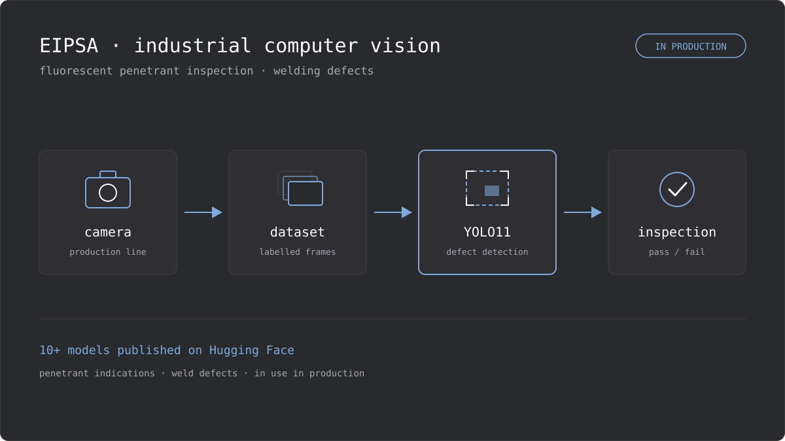
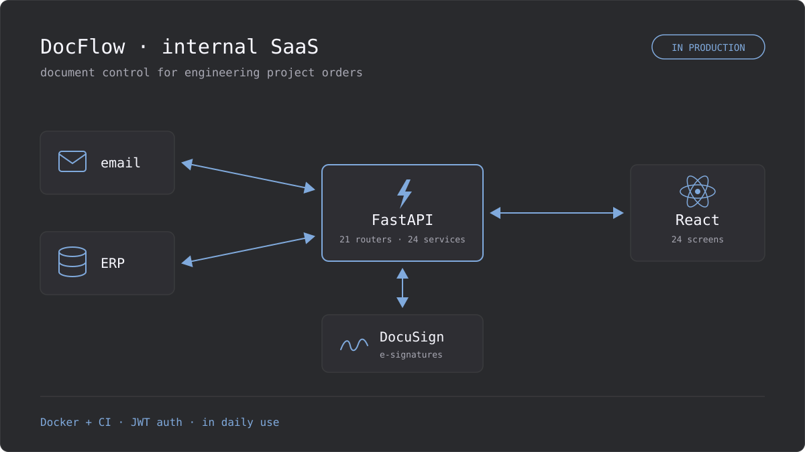
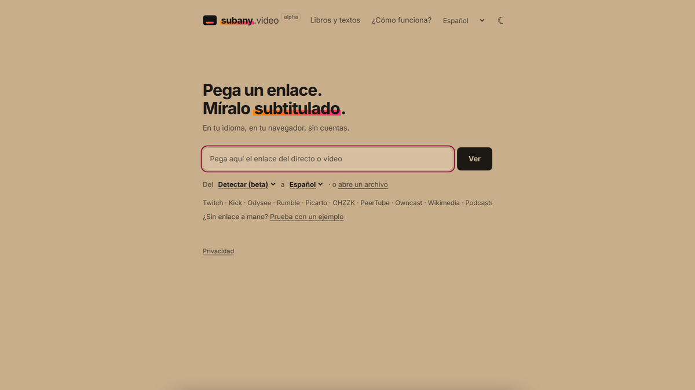

+++
title = "Projects"
translationKey = "projects"
user = "projects"
showMetadata = false
+++

Three builds, each with the problem, what I did and the result. Everything here is live or in production.

## Case studies

<section class="case">

### Industrial computer vision — EIPSA {#vision}

<figure class="caseMedia">
  
  <figcaption>camera → dataset → YOLO11 → inspection</figcaption>
</figure>

**Problem.** Penetrant and weld inspection depends on a trained eye: defects are small, varied and easy to miss at production pace.

**What I did.** Trained YOLO11 detectors for fluorescent penetrant indications and welding defects, and published 10+ models on Hugging Face.

**Result.** In production — the detectors run on real inspection work, not a benchmark.

<ul class="caseChips">
  <li>YOLO11</li>
  <li>Hugging Face</li>
</ul>

[Penetrant model on Hugging Face](https://huggingface.co/jparedesDS/fluorescent-penetrant-inspection) · [More models](https://huggingface.co/jparedesDS) · [Welding detector on GitHub](https://github.com/jparedesDS/welding-defects-detection)

</section>

<section class="case">

### DocFlow — document control SaaS {#docflow}

<figure class="caseMedia">
  
  <figcaption>email / ERP ↔ FastAPI ↔ React · DocuSign · Docker + CI</figcaption>
</figure>

**Problem.** Engineering project orders generate documents that must be tracked, reviewed and signed across email and the ERP.

**What I did.** Built the internal SaaS end to end: a FastAPI backend with 21 API routers and 24 services, a React frontend with 24 screens, DocuSign for signatures, JWT auth, and Docker + CI for deployment.

**Result.** In production and in daily use.

<ul class="caseChips">
  <li>FastAPI</li>
  <li>React</li>
  <li>DocuSign</li>
  <li>JWT</li>
  <li>Docker</li>
  <li>CI</li>
</ul>

[Code on GitHub](https://github.com/jparedesDS/docflow)

</section>

<section class="case">

### subany.video — subtitles in the browser {#subany}

<figure class="caseMedia">
  
  <figcaption>subany.video — paste a link, watch it subtitled.</figcaption>
</figure>

**Problem.** Live streams have no subtitles in the viewer's language, and server-side transcription adds cost and latency.

**What I did.** Built a fixed-delay player with Whisper speech recognition, Silero VAD and ONNX/WebGPU inference — all in the browser, no servers.

**Result.** Measured 15.3 s fixed delay against a 15 s target, with a median subtitle offset of 0–40 ms.

<ul class="caseChips">
  <li>Whisper</li>
  <li>Silero VAD</li>
  <li>ONNX/WebGPU</li>
</ul>

[Open subany.video](https://subany.video/) · [How it works](/blog/2026/11/09/how-subany-video-works/)

</section>

## Active products

- [subany.video](https://subany.video/) — live subtitles and translation for streams, processed locally in the browser.
- [subany.site](https://subany.site/) — the project site for subany.video.
- [CleanYourPhone](https://www.cleanyourphone.org/) — reversible Android debloat without root.
- [CleanYourMail](https://www.cleanyourmail.org/) — reversible inbox cleanup for coding agents.
- [Pro POV CS2](https://propovcs2.com/) — autonomous esports content pipeline for Counter-Strike 2.

## Selected work

- [HLTV Team & Player Stats Scraper](https://github.com/jparedesDS/hltv-scraper) — CS2 statistics scraping and analysis.
- [Technical Drawing Data Extraction](https://github.com/jparedesDS/extract-data-dxf) — deep learning for DXF technical drawings.
- [OCR Weapon Detection](https://github.com/jparedesDS/OCR-Identification-CS2-Weapons) — screen capture and OCR for CS2 weapon names.

## Archive

More repositories and model releases on [GitHub](https://github.com/jparedesDS).