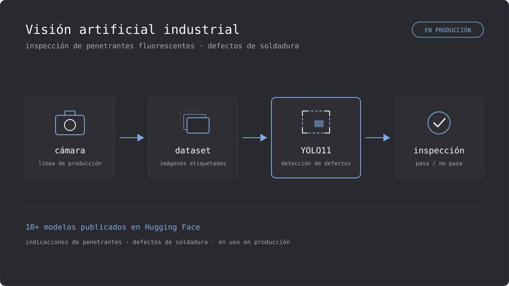
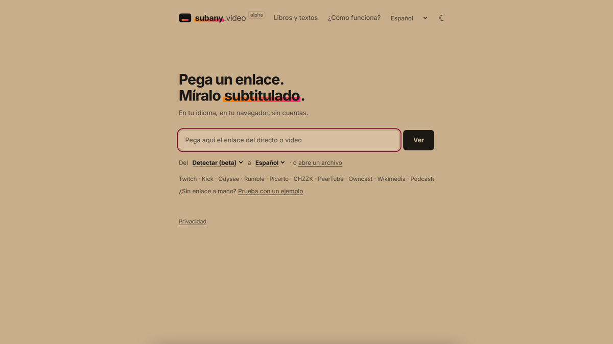

+++
title = "Proyectos"
translationKey = "projects"
user = "proyectos"
showMetadata = false
+++

Tres proyectos, cada uno con su problema, lo que hice y el resultado. Todo lo que ves aquí está publicado o en producción.

## Casos

<section class="case">

### Visión artificial industrial {#vision}

<figure class="caseMedia">
  
  <figcaption>cámara → dataset → YOLO11 → inspección</figcaption>
</figure>

**Problema.** La inspección de penetrantes y de soldadura depende del ojo del inspector: los defectos son pequeños, variados y fáciles de pasar por alto al ritmo de producción.

**Qué hice.** Entrené detectores YOLO11 para indicaciones de penetrantes fluorescentes y defectos de soldadura, y publiqué 10+ modelos en Hugging Face.

**Resultado.** En uso en producción: los detectores trabajan en inspección real, no en un benchmark.

<ul class="caseChips">
  <li>YOLO11</li>
  <li>Hugging Face</li>
</ul>

[Modelo de penetrantes en Hugging Face](https://huggingface.co/jparedesDS/fluorescent-penetrant-inspection) · [Más modelos](https://huggingface.co/jparedesDS) · [Detector de soldadura en GitHub](https://github.com/jparedesDS/welding-defects-detection)

</section>

<section class="case">

### DocFlow — SaaS de control documental {#docflow}

<figure class="caseMedia">
  
  <figcaption>correo / ERP ↔ FastAPI ↔ React · DocuSign · Docker + CI</figcaption>
</figure>

**Problema.** Los pedidos de ingeniería generan documentos que hay que seguir, revisar y firmar entre el correo y el ERP.

**Qué hice.** Construí el SaaS interno de principio a fin: backend FastAPI con 21 routers de API y 24 servicios, frontend React con 24 pantallas, firmas con DocuSign, autenticación JWT y despliegue con Docker + CI.

**Resultado.** En producción y en uso diario.

<ul class="caseChips">
  <li>FastAPI</li>
  <li>React</li>
  <li>DocuSign</li>
  <li>JWT</li>
  <li>Docker</li>
  <li>CI</li>
</ul>

El repositorio público es DocFlow Lite, una aplicación de escritorio en CustomTkinter; el SaaS descrito aquí es interno.

[DocFlow Lite en GitHub](https://github.com/jparedesDS/docflow)

</section>

<section class="case">

### subany.video — subtítulos en el navegador {#subany}

<figure class="caseMedia">
  
  <figcaption>subany.video: pega un enlace y míralo subtitulado.</figcaption>
</figure>

**Problema.** Los directos no tienen subtítulos en el idioma de quien los ve, y transcribir en un servidor añade coste y latencia.

**Qué hice.** Construí un reproductor con retardo fijo: Whisper para el reconocimiento de voz, Silero VAD y ONNX/WebGPU para la inferencia, todo en el navegador y sin servidores.

**Resultado.** Retardo fijo medido de 15,3 s sobre un objetivo de 15 s, con un desfase mediano de subtítulos de 0–40 ms.

<ul class="caseChips">
  <li>Whisper</li>
  <li>Silero VAD</li>
  <li>ONNX/WebGPU</li>
</ul>

[Abrir subany.video](https://subany.video/) · [Cómo funciona](/blog/2026/11/09/how-subany-video-works/)

</section>

## Productos activos

- [subany.video](https://subany.video/) — subtítulos en directo en el navegador, procesados en local.
- [subany.site](https://subany.site/) — el sitio del proyecto subany.video.
- [CleanYourPhone](https://www.cleanyourphone.org/) — limpieza reversible de Android sin root.
- [CleanYourMail](https://www.cleanyourmail.org/) — limpieza reversible del buzón de correo.
- [Pro POV CS2](https://propovcs2.com/) — pipeline autónomo de contenido de esports para Counter-Strike 2.

## Trabajo seleccionado

- [HLTV Team & Player Stats Scraper](https://github.com/jparedesDS/hltv-scraper) — scraping y análisis de estadísticas de CS2.
- [Technical Drawing Data Extraction](https://github.com/jparedesDS/extract-data-dxf) — deep learning para extracción de datos de planos DXF.
- [Detección de armas en CS2](https://github.com/jparedesDS/cs2-yolo12m-weapon-detection) - detección de 19 clases con YOLO12m.

## Archivo

El resto de repositorios y modelos, en [GitHub](https://github.com/jparedesDS).