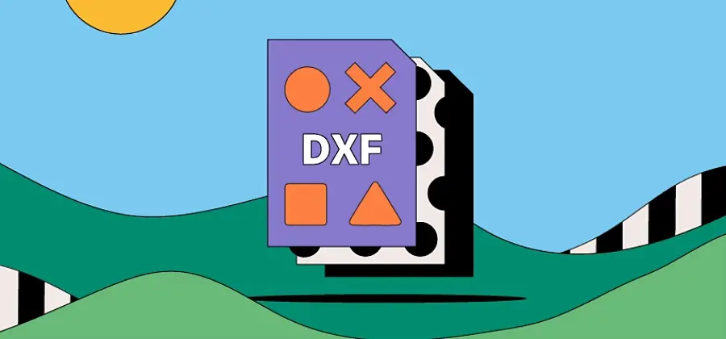

+++
title = "Proyectos"
translationKey = "projects"
user = "proyectos"
showMetadata = false
+++

Nueve proyectos, cada uno con su imagen, una explicación corta y sus enlaces. Todo está publicado o en producción.

<section class="projectRow">

<h3>Visión artificial industrial</h3>

Detectores YOLO11 para indicaciones de penetrantes y defectos de soldadura, publicados como 10+ modelos en Hugging Face y utilizados en inspección real.

<ul class="projectChips"><li>YOLO11</li><li>Hugging Face</li><li>Producción</li></ul>

<a href="https://huggingface.co/jparedesDS/fluorescent-penetrant-inspection" target="_blank" rel="noopener noreferrer">Modelo de penetrantes</a><a href="https://huggingface.co/jparedesDS" target="_blank" rel="noopener noreferrer">Más modelos</a><a href="https://github.com/jparedesDS/welding-defects-detection" target="_blank" rel="noopener noreferrer">Detector de soldadura</a>

</section>

<section class="projectRow">

<h3>DocFlow — control documental</h3>

SaaS interno construido de principio a fin: backend FastAPI con 21 routers y 24 servicios, frontend React con 24 pantallas, firmas con DocuSign y despliegue con Docker + CI. El repositorio público es DocFlow Lite.

<ul class="projectChips"><li>FastAPI</li><li>React</li><li>DocuSign</li><li>Docker</li></ul>

<a href="https://github.com/jparedesDS/docflow" target="_blank" rel="noopener noreferrer">DocFlow Lite en GitHub</a>

</section>

<section class="projectRow">

<h3>subany.video — subtítulos en el navegador</h3>

Subtítulos en directo procesados en local con Whisper, Silero VAD y ONNX/WebGPU, sin servidores. Retardo fijo de 15,3 s y desfase mediano de 0–40 ms.

<ul class="projectChips"><li>Whisper</li><li>Silero VAD</li><li>WebGPU</li></ul>

<a href="https://subany.video/" target="_blank" rel="noopener noreferrer">Abrir subany.video</a><a href="https://subany.site/" target="_blank" rel="noopener noreferrer">subany.site</a><a href="/en/blog/2026/11/09/how-subany-video-works/">Cómo funciona</a>

</section>

<section class="projectRow">

<h3>CleanYourPhone</h3>

Limpieza reversible de Android sin root: desactiva aplicaciones del sistema y permite devolver el dispositivo a su estado original.

<ul class="projectChips"><li>Android</li><li>Sin root</li></ul>

<a href="https://www.cleanyourphone.org/" target="_blank" rel="noopener noreferrer">Abrir CleanYourPhone</a>

</section>

<section class="projectRow">

<h3>CleanYourMail</h3>

Limpieza reversible del buzón de correo: organiza y elimina mensajes antiguos sin perder el hilo de las conversaciones.

<ul class="projectChips"><li>Email</li><li>Python</li></ul>

<a href="https://www.cleanyourmail.org/" target="_blank" rel="noopener noreferrer">Abrir CleanYourMail</a>

</section>

<section class="projectRow">

<h3>Pro POV CS2</h3>

Pipeline autónomo de contenido de esports para Counter-Strike 2: clips, resúmenes y publicación en redes.

<ul class="projectChips"><li>CS2</li><li>Esports</li><li>Automatización</li></ul>

<a href="https://propovcs2.com/" target="_blank" rel="noopener noreferrer">Abrir Pro POV</a><a href="https://www.tiktok.com/@propov_cs2" target="_blank" rel="noopener noreferrer">TikTok</a>

</section>

<section class="projectRow">

<h3>HLTV Team &amp; Player Stats Scraper</h3>

Scraping y análisis de estadísticas de equipos y jugadores de CS2 a partir de HLTV.

<ul class="projectChips"><li>Python</li><li>Scraping</li><li>CS2</li></ul>

<a href="https://github.com/jparedesDS/hltv-scraper" target="_blank" rel="noopener noreferrer">Código en GitHub</a>

</section>

<section class="projectRow">

<h3>Extracción de datos en planos DXF</h3>

Deep learning para identificar entidades en planos técnicos DXF y automatizar su documentación.

<ul class="projectChips"><li>Deep Learning</li><li>DXF</li><li>OCR</li></ul>

<a href="https://github.com/jparedesDS/extract-data-dxf" target="_blank" rel="noopener noreferrer">Código en GitHub</a>

</section>

<section class="projectRow">

<h3>Detección de armas en CS2</h3>

Detector de 19 clases de armas en Counter-Strike 2 con YOLO12m y modelo publicado en Hugging Face.

<ul class="projectChips"><li>YOLO12m</li><li>CS2</li><li>Hugging Face</li></ul>

<a href="https://github.com/jparedesDS/cs2-yolo12m-weapon-detection" target="_blank" rel="noopener noreferrer">Código en GitHub</a><a href="https://huggingface.co/jparedesDS/cs2-yolo12m-weapon-detection" target="_blank" rel="noopener noreferrer">Modelo en Hugging Face</a>

</section>

El resto de repositorios y modelos, en [GitHub](https://github.com/jparedesDS) y [Hugging Face](https://huggingface.co/jparedesDS).
