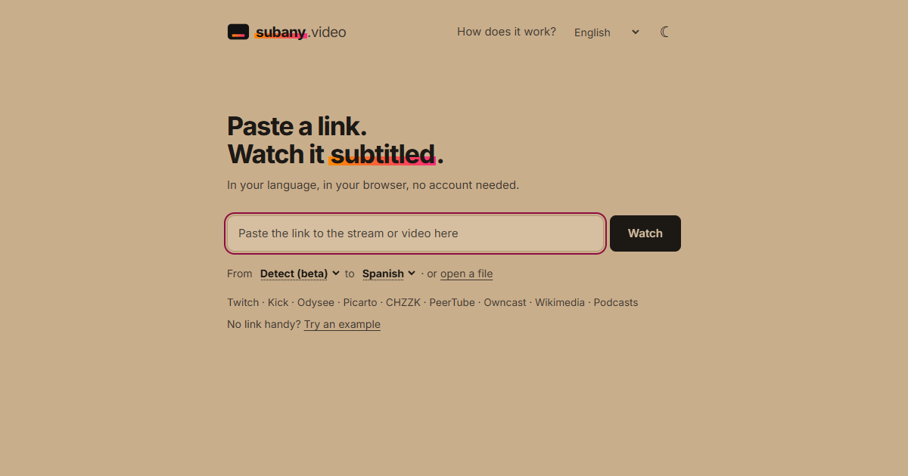
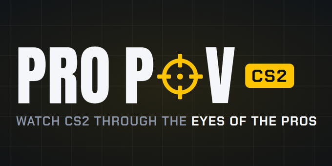
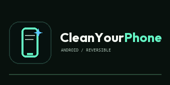

  <header class="home-intro">
    
Data Scientist · Madrid, Spain

    <h1>Building useful AI products.</h1>
    
Computer vision, local-first software and automation.

  </header>

  <main>
    <section class="hero-project" aria-labelledby="subany-title">
      

        
Featured project · Open source

        <h2 id="subany-title">subany.video</h2>
        
Any video, in your language.

        
Live subtitles and translation for streams and videos, processed privately in your browser. No account needed.

        

          <a class="button button-primary" href="https://subany.video/">Try subany.video ↗</a>
          <a class="button button-secondary" href="https://github.com/jparedesDS/subtitle.me">View code</a>
        

      

      
    </section>

    <section class="selected-work" id="selected-work" aria-labelledby="selected-work-title">
      

        <h2 id="selected-work-title">Selected work</h2>
        <a href="#more-work">More projects ↓</a>
      

      

        <a class="work-card" href="/cleanyourmail/">
          
          

            

              <h3>CleanYourMail</h3>
              →
            

            
Reversible, local-first inbox cleanup for coding agents.

          

        </a>

        <a class="work-card" href="/propovcs2/">
          
          

            

              <h3>Pro POV CS2</h3>
              →
            

            
An autonomous pipeline from pro demos to published content.

          

        </a>

        <a class="work-card" href="/projects/products/">
          
          

            

              <h3>CleanYourPhone</h3>
              →
            

            
Safe, reversible Android debloating without root.

          

        </a>
      

    </section>
  </main>

  <footer>
    <section class="home-about" id="about" aria-labelledby="about-title">
      
      

        <h2 id="about-title">About</h2>
        
I’m Jose, a Data Scientist at EIPSA building computer-vision systems and automation for engineering and manufacturing.

        

          <a href="mailto:jparedescolmenarejo@gmail.com">Email</a>
          <a href="https://www.linkedin.com/in/jparedesDS/">LinkedIn</a>
          <a href="https://github.com/jparedesDS">GitHub</a>
          <a href="resume.pdf">CV</a>
        

      

    </section>

    <nav class="more-work" id="more-work" aria-label="More projects">
      Explore more
      

        <a href="/projects/ai-vision/">AI &amp; Vision</a>
        <a href="/projects/data-automation/">Data &amp; Automation</a>
        <a href="/projects/products/">Products &amp; Tools</a>
        <a href="/projects/esports/">Esports &amp; Content</a>
      

    </nav>
  </footer>

