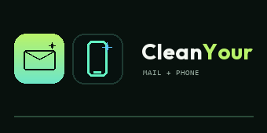

  <aside class="home-sidebar">
    
    <h2>About</h2>
    
Data Scientist based in Madrid, focused on Computer Vision, Deep Learning, NLP and automation. At EIPSA I build object-detection models for metallurgy, automate document control and turn technical drawings into structured data.

    
I like local-first software, reversible workflows and tools that explain what they do before they do it.

    <ul class="focus-list">
      <li>Computer Vision</li>
      <li>Deep Learning</li>
      <li>NLP</li>
      <li>Data Analysis</li>
      <li>Automation</li>
    </ul>
    <h3>Contact</h3>
    <ul class="contact-list">
      <li><a href="mailto:jparedescolmenarejo@gmail.com">Email</a></li>
      <li><a href="resume.pdf">CV</a></li>
      <li><a href="https://www.linkedin.com/in/jparedesDS/">LinkedIn</a></li>
      <li><a href="https://github.com/jparedesDS">GitHub</a></li>
      <li><a href="https://huggingface.co/jparedesDS">Hugging Face</a></li>
      <li><a href="https://www.kaggle.com/joseparedesc">Kaggle</a></li>
      <li><a href="https://twitter.com/xhitoCS">X / Twitter</a></li>
      <li><a href="https://buymeacoffee.com/joseparedes">☕ Buy me a coffee</a></li>
    </ul>
  </aside>

  <main class="home-main">
    <h2 id="my-portfolio">My Portfolio</h2>

    <h3>Featured projects</h3>

    

      
      
Special project · Free for everyone · Open source

      <h3><a href="/projects/products/">CleanYour — free, reversible tools for your phone and inbox</a></h3>
      
CleanYourMail and CleanYourPhone remove noise without deleting anything: headers-only inbox cleanup and reversible Android debloat. Local, no accounts, no telemetry, one command to undo.

      
4 repositories · MIT · one command to undo

      

        <a href="/projects/products/">Suite details →</a>
        <a href="/cleanyourmail/">CleanYourMail</a>
        <a href="https://github.com/jparedesDS/cleanyourmail">Mail code</a>
        <a href="https://jparedesds.github.io/cleanyourmail-web/">Mail site</a>
        <a href="https://github.com/jparedesDS/clean-your-phone">Phone code</a>
        <a href="https://jparedesds.github.io/cleanyourphone-web/">Phone site</a>
      

    

    

      
      
Featured project · Esports · Automation

      <h3><a href="/projects/esports/">Pro POV CS2 — autonomous esports content pipeline</a></h3>
      
Finds pro CS2 matches, downloads and parses demos, records the player's POV with CS2 + HLAE, renders per-round chapters and vertical clips, and publishes to YouTube, Shorts, TikTok, Instagram Reels and X unattended.

      
YouTube · Shorts · TikTok · Instagram · X

      

        <a href="/projects/esports/">Details →</a>
        <a href="https://github.com/jparedesDS/cs2data">Code (private)</a>
        <a href="https://www.youtube.com/@Pro-POV-CS2">YouTube</a>
        <a href="https://www.tiktok.com/@propov.cs2">TikTok</a>
        <a href="https://x.com/ProPOVCS2">X</a>
      

    

    <h3>Project categories</h3>

    

      <a class="category-card" href="/projects/ai-vision/">
        01
        <h4>AI &amp; Computer Vision</h4>
        
Object detection, OCR, image classification and technical-drawing models.

        7 projects · 10 model releases →
      </a>
      <a class="category-card" href="/projects/data-automation/">
        02
        <h4>Data &amp; Automation</h4>
        
Document control, ERP integrations, reporting pipelines, scrapers and analysis.

        11 projects →
      </a>
      <a class="category-card" href="/projects/products/">
        03
        <h4>Products &amp; Tools</h4>
        
Self-hosted products, free open-source tools and automation agents.

        5 projects →
      </a>
      <a class="category-card" href="/projects/esports/">
        04
        <h4>Esports &amp; Content</h4>
        
CS2 analytics, content automation and esports products.

        3 projects →
      </a>
    

  </main>

