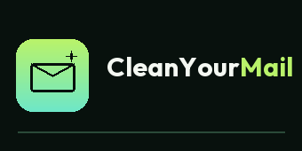
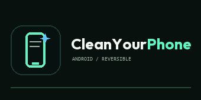
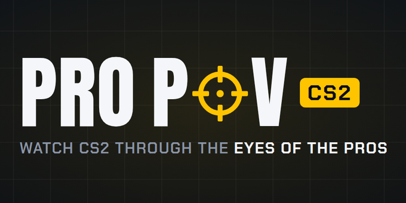
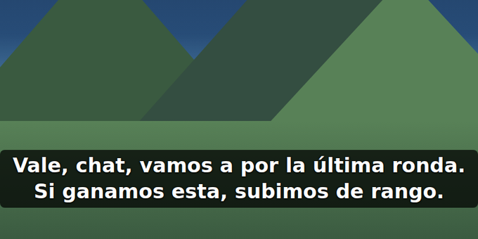
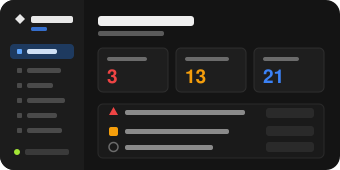
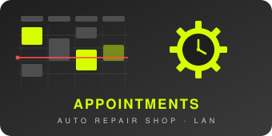
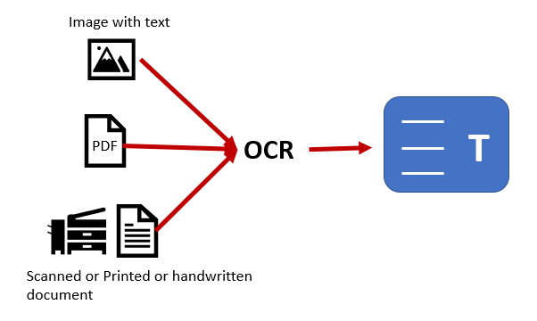

  <aside class="home-sidebar">
    
    <h2>About</h2>
    
Data Scientist based in Madrid, focused on Computer Vision, Deep Learning, NLP and automation. At EIPSA I build object-detection models for metallurgy, automate document control and turn technical drawings into structured data.

    
I like local-first software, reversible workflows and tools that explain what they do before they do it.

    <ul class="focus-list">
      <li>Computer Vision</li>
      <li>Deep Learning</li>
      <li>NLP</li>
      <li>Data Analysis</li>
      <li>Automation</li>
    </ul>
    <h3>Contact</h3>
    <ul class="contact-list">
      <li><a href="mailto:jparedescolmenarejo@gmail.com">Email</a></li>
      <li><a href="resume.pdf">CV</a></li>
      <li><a href="https://www.linkedin.com/in/jparedesDS/">LinkedIn</a></li>
      <li><a href="https://github.com/jparedesDS">GitHub</a></li>
      <li><a href="https://huggingface.co/jparedesDS">Hugging Face</a></li>
      <li><a href="https://www.kaggle.com/joseparedesc">Kaggle</a></li>
      <li><a href="https://twitter.com/xhitoCS">X / Twitter</a></li>
      <li><a href="https://buymeacoffee.com/joseparedes">☕ Buy me a coffee</a></li>
    </ul>
  </aside>

  <main class="home-main">
    <h2 id="my-portfolio">My Portfolio</h2>

    <h3>Featured projects</h3>

    

      
      
Free for everyone · Open source · Agent-native

      <h3><a href="/cleanyourmail/">CleanYourMail — your inbox, minus the noise</a></h3>
      
A local skill for coding agents that reads email headers only, files newsletters, promotions and spam, and unsubscribes safely. Every move is journaled and reversible; nothing is permanently deleted.

      
145 tests · 10 languages · 7 provider presets · MIT

      

        <a href="/cleanyourmail/">Case study →</a>
        <a href="https://github.com/jparedesDS/cleanyourmail-app">Local app</a>
        <a href="https://github.com/jparedesDS/cleanyourmail">Code</a>
        <a href="https://jparedesds.github.io/cleanyourmail-web/">Site</a>
        <a href="https://github.com/jparedesDS/cleanyourmail/releases/tag/v1.1.5">Release</a>
      

    

    

      
      
Free for everyone · Open source · Android

      <h3><a href="/projects/products/">CleanYourPhone — your phone, minus the bloat</a></h3>
      
An open-source, reversible Android debloat skill for coding agents. Disables preinstalled apps and services over ADB: no root, no custom ROM, nothing uninstalled, one command to undo.

      
157 profiles · 6 brands · MIT

      

        <a href="/projects/products/">Details →</a>
        <a href="https://github.com/jparedesDS/clean-your-phone">Code</a>
        <a href="https://jparedesds.github.io/cleanyourphone-web/">Site</a>
      

    

    

      
      
Featured project · Esports · Automation

      <h3><a href="/projects/esports/">Pro POV CS2 — autonomous esports content pipeline</a></h3>
      
Finds pro CS2 matches, downloads and parses demos, records the player's POV with CS2 + HLAE, renders per-round chapters and vertical clips, and publishes to YouTube, Shorts, TikTok, Instagram Reels and X unattended.

      
YouTube · Shorts · TikTok · Instagram · X

      

        <a href="/projects/esports/">Details →</a>
        <a href="https://github.com/jparedesDS/cs2data">Code (private)</a>
        <a href="https://www.youtube.com/@Pro-POV-CS2">YouTube</a>
        <a href="https://www.tiktok.com/@propov.cs2">TikTok</a>
        <a href="https://x.com/ProPOVCS2">X</a>
      

    

    <h3>Latest projects</h3>
    
Recent work across products, automation and computer vision.

    

      <a class="latest-card" href="https://github.com/jparedesDS/trtw-tv">
        
        <h4>trtw.tv</h4>
        
Live Spanish subtitles for Twitch &amp; YouTube, running locally with Whisper and Chrome Translator.

        View project →
      </a>
      <a class="latest-card" href="https://github.com/jparedesDS/docflow">
        
        <h4>DocFlow SaaS</h4>
        
Document control for engineering projects: 8 client portals, ERP read-only, automated reports and AI summaries.

        View project →
      </a>
      <a class="latest-card" href="/projects/products/">
        
        <h4>Polymarket Auto-Betting Bot</h4>
        
BTC prediction-market bot with Kelly sizing, Monte Carlo backtesting and a Telegram dashboard.

        View project →
      </a>
      <a class="latest-card" href="https://github.com/jparedesDS/talleres-ritmo">
        
        <h4>Appointment Management</h4>
        
Self-hosted scheduling and customer/vehicle management for auto repair shops.

        View project →
      </a>
      <a class="latest-card" href="https://github.com/jparedesDS/claude-telegram">
        
        <h4>Claude Telegram Bot</h4>
        
Claude in Telegram for notifications, approvals and remote control from your phone.

        View project →
      </a>
      <a class="latest-card" href="https://github.com/jparedesDS/OCR-Identification-CS2-Weapons">
        
        <h4>OCR Weapon Detection</h4>
        
Screen OCR that identifies Counter-Strike 2 weapon names in real time.

        View project →
      </a>
    

  </main>

